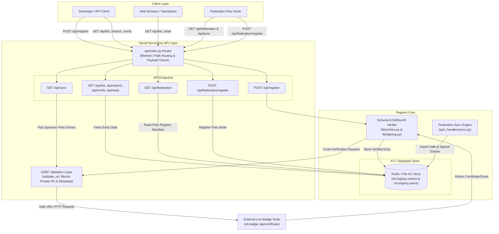

[](https://nti-registry.vercel.app)

# NTI Registry

**Federated, cryptographically signed directory of every NTI-1 certified tool.**

[](https://opensource.org/licenses/Apache-2.0)

## Why This Is Different

Existing registries (PyPI, npm, awesome-lists) let anyone claim anything. This registry requires **cryptographic proof of compliance**:

- Every entry is **Dilithium5-signed** by the tool owner using `ube-foundation`
- Every entry is **cross-verified against a live nti-badge node**
- Every entry is **machine-readable** for AI agent discovery
- Every entry is **offline-verifiable** forever
- The registry is **federated** — anyone can mirror it

No central authority. No silent edits. No self-claimed trust.

---

## Local Development

### Requirements
- Python 3.10+
- `ube-foundation`, `httpx`, `click`, `rich`, `redis`

### Running Locally
```bash
pip install -r requirements.txt
python api/index.py
```
The server will start at `http://127.0.0.1:8000`.

### Running Tests
```bash
python3 -m pytest -n auto --random-order
```

---

## Vercel Deployment

Deploy directly to Vercel using the Vercel CLI or Git integration:

```bash
vercel --prod
```

`vercel.json` automatically routes `/api/*` traffic to the serverless entrypoint `api/index.py` and serves static assets from `web/`.

### Storage Configuration
Set `KV_URL` or `REDIS_URL` in environment variables for persistent Redis storage. If omitted, the registry falls back to local file-based storage.

---

## Endpoints Specification

### Core Registry APIs

#### `POST /api/register`
Submit a signed registry entry for verification and indexing.
- **Request Body**:
  ```json
  {
    "entry": {
      "spec": "NTI-Registry-Entry/1",
      "id": "uuid-v4-string",
      "name": "tool-name",
      "version": "1.0.0",
      "description": "Short description",
      "category": "framework",
      "repo_url": "https://github.com/owner/repo",
      "badge_url": "https://nti-badge-svs1.vercel.app",
      "nti_score": 95,
      "registered_at": "ISO-8601-Timestamp",
      "issuer_pubkey": "dilithium5-pubkey-hex",
      "signature": "dilithium5-signature-hex",
      "cert_hash": "sha256-payload-hash"
    },
    "strict": true
  }
  ```
- **Responses**:
  - `200 OK`: Registered successfully.
  - `400 Bad Request`: Hash mismatch, invalid signature, or cross-verification failure.
  - `413 Payload Too Large`: Body size exceeds 1MB.

#### `GET /api/list?limit=50`
Retrieve entry listing sorted by registration date (newest first).

#### `GET /api/verify?id=<uuid>`
Verify signature, hash integrity, and badge cross-verification for a specific entry.

#### `GET /api/search?q=<query>&category=<category>&min_score=<min>&max_score=<max>`
Filter indexed entries by search query, category, or NTI score range.

#### `GET /api/stats`
Return total entries, cross-verified entry count, average score, and category breakdown.

#### `GET /api/health`
Service health check and active storage backend details.

---

### Federation APIs

#### `GET /api/federation`
Retrieve registry manifest, node details, supported endpoints, and active peer list.

#### `POST /api/federation/register`
Announce a peer registry node for federation mirroring.

#### `GET /api/sync?from=<peer_url>`
Synchronize entries from an upstream peer node.

---

## License

Licensed under the Apache License, Version 2.0. See [LICENSE](LICENSE).

## Security & Bug Reports

Please refer to [SECURITY.md](SECURITY.md) for vulnerability disclosure procedures.

## Links

- NTI-1 Spec: https://abisheakp197.github.io/nti-spec/
- nti-scanner: https://pypi.org/project/nti-scanner/
- nti-badge: https://nti-badge-svs1.vercel.app
- nti-attack: https://pypi.org/project/nti-attack/
- nti-benchmark: https://pypi.org/project/nti-benchmark/

---

## Architecture


